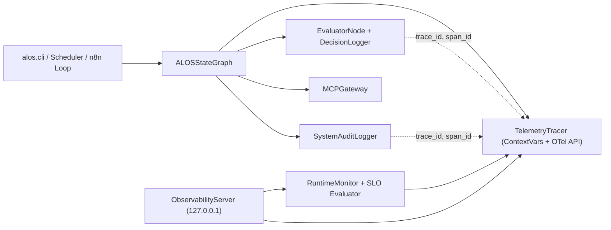

# Implementation Plan: Runtime Observability, Traceability, Metrics & Health Monitoring

**Spec**: [`spec.md`](spec.md) | **ADR**: `ADR-0014`

## Architecture Overview

## Module & Contract Layout

1. **`alos/core/protocols.py` & `alos/core/config.py`**:
   - Add `@runtime_checkable class TelemetryProtocol(Protocol)` for SOLID DIP injection.
   - Extend `ALOSConfig` with `telemetry_enabled`, `telemetry_log_path`, `observability_host`, `observability_port`, `latency_slo_ms`, and `error_rate_threshold`.
2. **`alos/logs/telemetry.py`**:
   - Extend `SpanContext` with `trace_id`, `parent_span_id`, `events`, `traceparent`, `add_event()`, and `parse_traceparent()`.
   - Upgrade `TelemetryTracer` with `threading.RLock`, `ContextVar` active span stack, OpenTelemetry `trace.get_tracer("alos.runtime")` bridge, optional JSONL sink, counters, gauges, histograms (`HistogramSummary`), `render_prometheus()`, and `snapshot()`, keeping full backward compatibility with `start_span`, `end_span`, `span`, `record_metric`, `get_spans`, `get_metrics`, `clear`, and `global_tracer`.
3. **`alos/logs/decision_log.py` & `alos/logs/system_audit.py`**:
   - Eliminate circular import in `decision_log.py` via `TYPE_CHECKING` guards.
   - Inject active `trace_id` and `span_id` into audit and ADR JSONL records.
4. **`alos/logs/monitor.py`**:
   - `ComponentHealth`, `SLOAlert`, `RuntimeStats`, `HealthReport` (Pydantic v2).
   - `RuntimeMonitor`: process telemetry, vault/journal/native readiness probes, SLO evaluation.
   - `ObservabilityServer`: stdlib `ThreadingHTTPServer` serving `/healthz`, `/readyz`, `/metrics`, `/traces`.
5. **Runtime Instrumentation & CLI (`alos/core/graph.py`, `evaluator.py`, `mcp_gateway.py`, `scheduler.py`, `langgraph_n8n_loop.py`, `cli.py`)**:
   - Instrument execution paths with child spans, counters, gauges, and duration histograms; add `alos observability` CLI subcommands.

## Constitution Gate Check

- **Article I & III (Determinism & Provenance)**: Pydantic v2 schemas for all telemetry/health payloads; immutable JSONL correlation via `trace_id`/`span_id`.
- **Article II (Local-First Privacy)**: Loopback-only default (`127.0.0.1`), local JSONL/in-memory storage, CrewAI cloud telemetry remains opted out.
- **Article IV & VII (TDD & Fix-First Quality)**: Red-Green-Refactor with `pytest` + `pytest-bdd` (`@mocked` and `@live`), `CC <= 10`, strict `ruff`, `mypy`, `bandit`, and `pyadr` gates.
